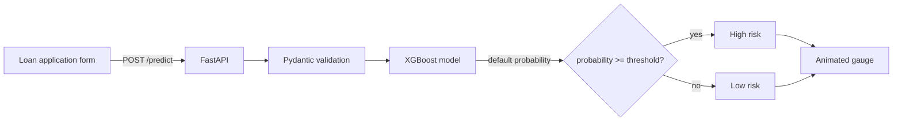

<div align="center">

<a href="https://loan-risk-wfiy.onrender.com/">
  
</a>

<br>

[](https://loan-risk-wfiy.onrender.com/)
[](https://loan-risk-wfiy.onrender.com/)


### 👉 **[loan-risk-wfiy.onrender.com](https://loan-risk-wfiy.onrender.com/)** 👈

</div>

---

## What it does

Enter a loan application and the model returns the **probability that the borrower will default**. The result is shown on a live gauge and compared against a tuned decision threshold to give a clear verdict: **Low risk** or **High risk**.

- Animated risk gauge with a cutoff marker, probability count-up and verdict
- Dark UI with example applicants (strong, typical, risky) to try in one click
- Loan-to-income ratio is calculated automatically as you type
- Input validation with clear messages, and a recent-checks list you can reload
- API status chip that wakes the server and shows when it's ready

> **Heads up:** the app runs on Render's free tier, so the server sleeps when idle. The first visit can take up to a minute to wake up. The status chip on the page shows "Waking the server…" while it starts.

## Live demo

**https://loan-risk-wfiy.onrender.com/**

Interactive API docs are generated by FastAPI at **[/docs](https://loan-risk-wfiy.onrender.com/docs)**.

## How it works



1. The browser sends the application as JSON to `/predict`.
2. Pydantic checks the field types, and the model returns a default probability.
3. The probability is compared with a threshold chosen during training (`best_threshold.pkl`).
4. The page animates the gauge to the result and shows the verdict.

## Model inputs

| Field | Type | Meaning |
|---|---|---|
| `person_age` | int | Applicant age in years |
| `person_income` | float | Annual income |
| `person_home_ownership` | str | `RENT`, `MORTGAGE`, `OWN`, `OTHER` |
| `person_emp_length` | float | Years in current job |
| `loan_intent` | str | `PERSONAL`, `EDUCATION`, `MEDICAL`, `VENTURE`, `HOMEIMPROVEMENT`, `DEBTCONSOLIDATION` |
| `loan_grade` | str | Loan grade `A` (best) to `G` (worst) |
| `loan_amnt` | float | Loan amount |
| `loan_int_rate` | float | Interest rate in percent |
| `loan_percent_income` | float | Loan amount ÷ income (the UI calculates this) |
| `cb_person_default_on_file` | str | Previous default: `Y` or `N` |
| `cb_person_cred_hist_length` | int | Credit history length in years |

## API

### `POST /predict`

```bash
curl -X POST https://loan-risk-wfiy.onrender.com/predict \
  -H "Content-Type: application/json" \
  -d '{
    "person_age": 28,
    "person_income": 55000,
    "person_home_ownership": "RENT",
    "person_emp_length": 4,
    "loan_intent": "PERSONAL",
    "loan_grade": "B",
    "loan_amnt": 10000,
    "loan_int_rate": 11.0,
    "loan_percent_income": 0.18,
    "cb_person_default_on_file": "N",
    "cb_person_cred_hist_length": 5
  }'
```

Response (the numbers depend on the model):

```json
{
  "default_probability": 0.12,
  "default_prediction": 0,
  "threshold": 0.45,
  "result": "Low risk"
}
```

### `GET /health`

Returns `{"status": "ok"}`. The page uses it to show the connection status.

## Run it locally

```bash
git clone https://github.com/<your-username>/<your-repo>.git
cd <your-repo>

python -m venv .venv
# Windows
.venv\Scripts\activate
# macOS / Linux
source .venv/bin/activate

pip install -r requirements.txt
uvicorn main:app --reload
```

Then open **http://127.0.0.1:8000**. The API serves the page itself, so there is nothing else to start.

## Project structure

```
.
├── main.py                  # FastAPI app: /predict, /health, serves the UI
├── credit_risk_model.pkl    # trained model
├── best_threshold.pkl       # tuned decision threshold
├── requirements.txt         # pinned dependencies
├── .python-version          # Python version for Render
├── static/
│   ├── index.html
│   ├── style.css
│   └── script.js
├── assets/
│   └── banner.svg           # animated README banner
└── Loan_Risk.ipynb          # model training notebook
```

## Deploy on Render

1. Push the repo to GitHub.
2. Create a **Web Service** on [Render](https://render.com) and connect the repo.
3. Use these settings:

| Setting | Value |
|---|---|
| Runtime | Python 3 |
| Build command | `pip install -r requirements.txt` |
| Start command | `uvicorn main:app --host 0.0.0.0 --port $PORT` |

Render reads the Python version from `.python-version`. Pin `xgboost` and `scikit-learn` in `requirements.txt` to the versions the model was trained and tested with, because a pickled model can fail to load on a different version.

## Tech stack

- **Backend:** FastAPI, Uvicorn, Pydantic
- **ML:** XGBoost, scikit-learn, pandas, NumPy, joblib
- **Frontend:** plain HTML, CSS and JavaScript (no framework or build step)
- **Hosting:** Render

## Disclaimer

The score is a statistical estimate from a trained model. It can support a lending decision, but it does not replace one.

## License

Add a license of your choice (for example MIT) to this repository.
